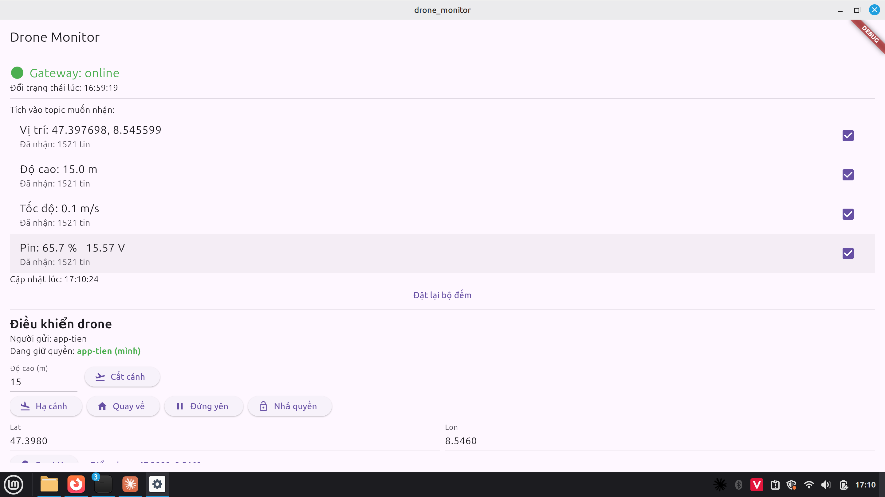
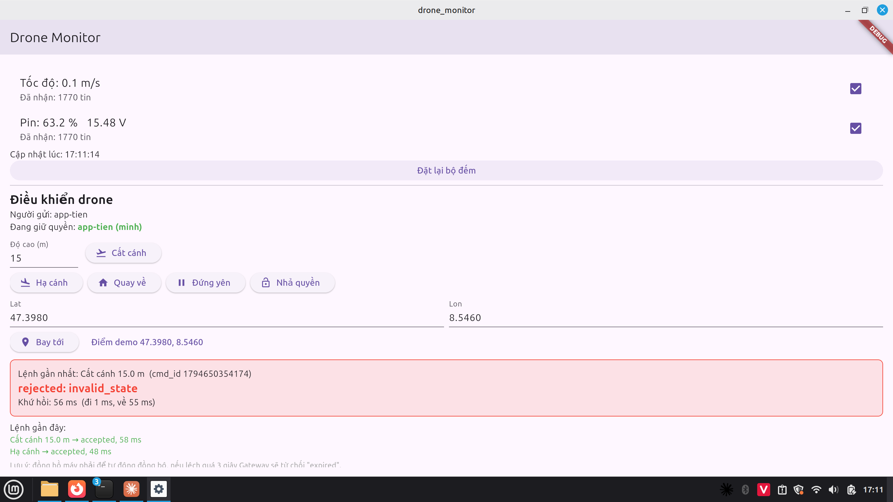
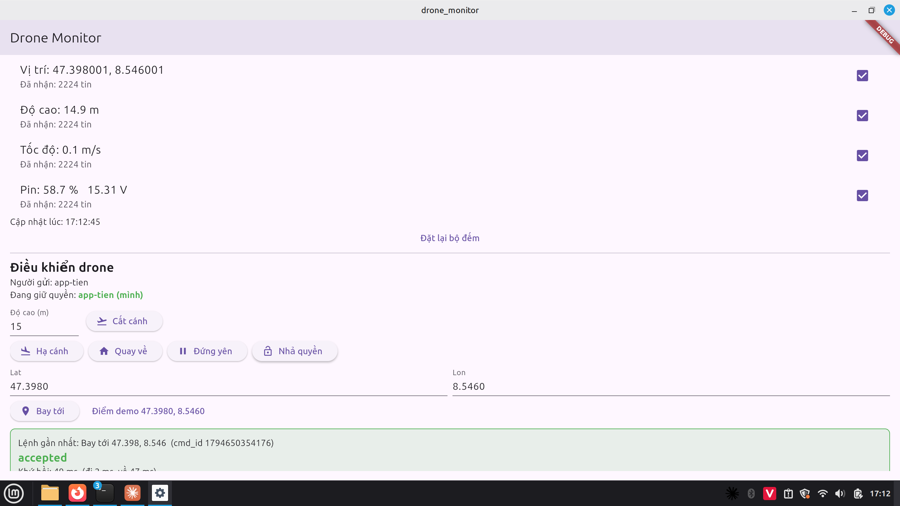
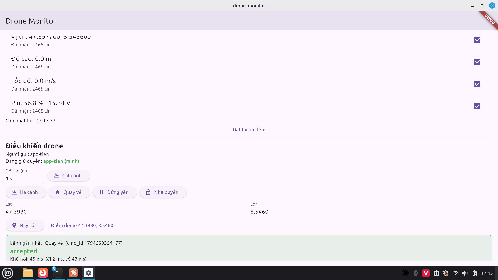
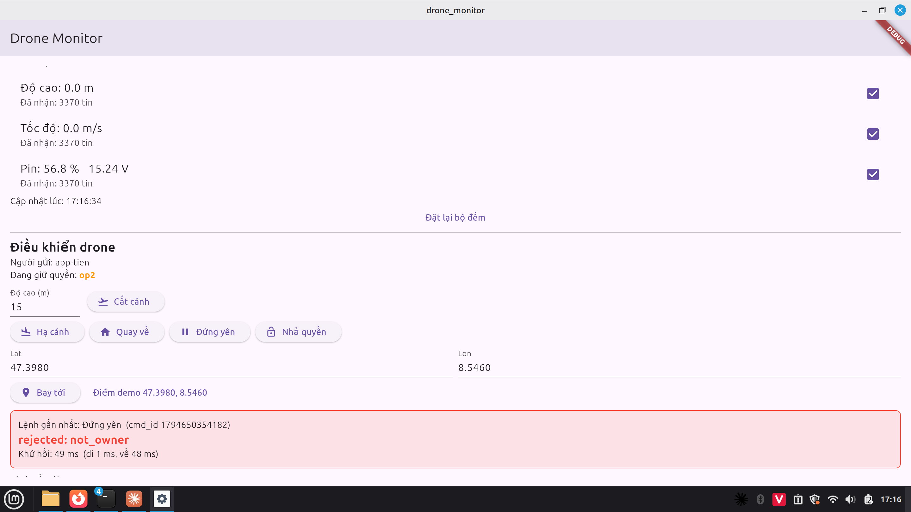

# Báo cáo – Kênh lệnh điều khiển drone (phần của Tiên, bản nháp)

> Số liệu lấy từ `data/H/summary.md` (sinh bằng `./scripts/summarize_H.sh`). Còn thiếu: link video H2.

## 1. Hai chiều dữ liệu trên cùng một Broker

```
                 drone/001/{position,altitude,velocity,battery,status}   (telemetry, chiều lên)
 drone ──▶ Gateway ───────────────────────────────────────▶ Broker ──▶ App / Logger
   ▲          │  ▲                                            │  ▲
   │          │  └──────────── drone/001/cmd  (lệnh, chiều xuống) ──┘  │
   └──────────┘ ─────────────── drone/001/cmd/ack (kết quả) ─────────▶ App / commander
```

Với telemetry, mất một tin cũng không sao vì tin sau thay thế nó. Lệnh thì khác: lệnh **chạy muộn,
chạy hai lần hoặc do hai người cùng gửi** đều nguy hiểm. Chính các tính năng MQTT có ích cho telemetry
lại gây ra những lỗi này, nên Gateway phải kiểm tra từng lệnh trước khi chuyển cho drone.

## 2. Bốn nguy cơ và cách chặn

| # | Nguy cơ do tính năng MQTT | Cách chặn ở Gateway | reason khi từ chối |
|---|---|---|---|
| 1 | **Retained**: Broker gửi lại tin retained mỗi khi Gateway subscribe, tức là sau mỗi lần kết nối lại, nên lệnh cũ chạy lại | Từ chối mọi lệnh có cờ retained | `retained` |
| 2 | **Broker giữ tin QoS 1** khi Gateway vắng mặt (phiên bền), **Paho đệm tin** khi người gửi mất kết nối, nên lệnh tới muộn hàng giây đến hàng chục giây | Lệnh có hạn dùng `ttl_ms` (3 s), từ chối khi `gw_recv_ms − sent_ms > ttl_ms` | `expired` |
| 3 | **QoS 1 "ít nhất một lần"**: tin chưa có PUBACK bị gửi lại (cờ DUP), nên lệnh chạy hai lần | Nhớ cặp `(from, cmd_id)` đã xử lý | `duplicate` |
| 4 | **Ai cũng publish được** lên `drone/001/cmd`, nên hai người cùng điều khiển một drone | Người gửi lệnh hợp lệ đầu tiên giữ quyền; im lặng quá 5 s thì quyền tự nhả | `not_owner` |

## 3. App: nút điều khiển

App gửi lệnh JSON lên `drone/001/cmd` với QoS 1, **không retained**, `from = app-tien`,
`cmd_id` tăng dần bắt đầu từ giờ mở app, `ttl_ms = 3000`. App không tự gửi lại lệnh: bấm lại là một lệnh
mới. Ô kết quả hiện `accepted` (xanh) hoặc `rejected: <reason>` (đỏ) và thời gian khứ hồi, tách thành
chiều đi (App → Gateway) và chiều về (Gateway → App). Sau 3 s không có ack, App hiện "Không có phản hồi".
Dòng "Đang giữ quyền" lấy từ trường `owner` của mọi ack.

Đã kiểm tra với Broker và Gateway thật (`app/test/cmd_channel_live_test.dart`):

| Tình huống | Kết quả |
|---|---|
| Hạ cánh | `accepted`, khứ hồi 44 ms, độ cao về 0 m |
| Cất cánh 15 m, rồi cất cánh lần nữa | `accepted`, lên 14,9 m; lần hai `rejected: invalid_state` |
| Bay tới 47.3980, 8.5460 | `accepted`, tốc độ 5 m/s |
| `commander --from op2` ngay sau lệnh của App | op2 bị `not_owner`, App hiện "app-tien (mình)" |
| App nhả quyền, op2 gửi lệnh | App hiện người giữ quyền là `op2`, lệnh của App bị `not_owner` |
| Quay về | drone về 47.397700, 8.545600 rồi hạ cánh |
| Tắt Gateway rồi gửi lệnh | "Không có phản hồi (quá 3 giây)" |

Ảnh chụp màn hình App trên Linux desktop, Gateway `--source fake`:

| | |
|---|---|
|  Hạ cánh: độ cao 0.0 m |  Cất cánh 15 m: độ cao 15.0 m |
|  Cất cánh lần hai: `rejected: invalid_state` (hai lệnh trước `accepted`, 48 ms và 58 ms) |  Bay tới: tới 47.398001, 8.546001, `accepted` |
|  Quay về: về nhà, độ cao 0.0 m |  op2 giữ quyền: lệnh của App bị `rejected: not_owner` |
|  Tắt Gateway: "Không có phản hồi (quá 3 giây)" | |

## 4. Kết quả thí nghiệm H

Broker, Gateway (`--source fake`) và `commander` chạy cùng một máy Linux, chung đồng hồ.

### H1 – Thời gian khứ hồi lệnh (300 lệnh `hold` mỗi lượt, cách nhau 200 ms, 3 lượt mỗi ô)

| Điều kiện | QoS | Số lệnh | timeout | Trung vị (ms) | p95 (ms) | Lớn nhất (ms) | Đi / về trung vị (ms) |
|---|---|---|---|---|---|---|---|
| N0 | 0 | 900 | 0 | 2 | 41 | 43 | 1 / 1 |
| N0 | 1 | 900 | 0 | 42 | 43 | 44 | 1 / 41 |
| N1 (trễ 100 ms) | 0 | 900 | 0 | 346 | 395 | 499 | 242 / 101 |
| N1 (trễ 100 ms) | 1 | 900 | 0 | 449 | 498 | 503 | 225 / 201 |
| N2 (mất 5 %) | 0 | 900 | 0 | 2 | 235 | 656 | 1 / 1 |
| N2 (mất 5 %) | 1 | 900 | 0 | 80 | 330 | 834 | 18 / 41 |
| N3 (trễ 100 ms + mất 5 %) | 0 | 900 | 0 | 415 | 843 | 1510 | 209 / 200 |
| N3 (trễ 100 ms + mất 5 %) | 1 | 900 | 0 | 481 | 915 | 1852 | 200 / 254 |

Netem đặt trên card `eth0` của container Broker, nên chỉ các gói **Broker gửi ra** bị trễ hoặc mất.
Mỗi lệnh đi qua Broker hai lần theo chiều ra: Broker → Gateway (lệnh) và Broker → commander (ack).

Nhận xét chung:

- **Không mất lệnh nào** ở cả 4 điều kiện (0 timeout trên 7200 lệnh), kể cả QoS 0 khi mất 5 % gói. Lý do:
  mất gói xảy ra ở tầng IP, TCP truyền lại, nên ở tầng MQTT chỉ thấy lệnh tới muộn hơn. QoS 0 chỉ mất
  tin khi chính kết nối TCP bị đứt (như H3).
- **Lệnh chậm nhất là 1,85 s (N3, QoS 1), vẫn dưới hạn dùng 3 s**, nên trong mọi điều kiện đã thử,
  kiểm tra 2 không từ chối nhầm một lệnh hợp lệ nào. TTL 3 s còn dư khoảng 1,1 s so với lệnh chậm nhất.

Nhận xét N0:

- Không mất lệnh nào (0 timeout trên 1800 lệnh).
- **QoS 1 luôn khoảng 42 ms, và phần trễ nằm ở chiều về** (ack từ Gateway tới commander: 41 ms), chiều
  đi chỉ 1 ms. Chiến đã xác định nguyên nhân là Nagle của TCP gặp delayed ACK. Giả thuyết cụ thể hơn: với
  QoS 1, Broker ghi liền hai gói nhỏ về commander (PUBACK cho lệnh, rồi PUBLISH của ack). Nagle giữ gói
  thứ hai cho tới khi commander ACK gói thứ nhất, mà ACK đó bị trì hoãn khoảng 40 ms. Cần chụp Wireshark
  để xác nhận.
- QoS 0: lượt 1 cũng khoảng 40 ms (lần này trễ ở chiều đi), lượt 2 và 3 chỉ 2 ms. Như vậy với QoS 0 hiện
  tượng Nagle không xảy ra lần nào cũng như lần nào, nên phải báo cả p95 chứ không chỉ trung vị.

Nhận xét N1 (trễ 100 ms):

- Netem chỉ thêm 100 ms cho mỗi chiều Broker gửi ra, nên lẽ ra khứ hồi khoảng 200 ms. Thực tế là
  **346 ms (QoS 0) và 449 ms (QoS 1)**.
- Phần trễ thêm là Nagle. Một gói nhỏ phải chờ gói trước được ACK mới được gửi, mà khi mạng trễ thì
  thời gian chờ ACK tăng theo. Mỗi lần bị Nagle giữ lại tốn thêm khoảng 100 ms, thay vì khoảng 40 ms như ở N0.
- Tách theo chiều cho thấy rõ điều này:
  - Chiều về QoS 0 là 101 ms, chỉ có trễ netem, vì Broker chỉ gửi một gói ack.
  - Chiều về QoS 1 là 201 ms, gồm trễ netem cộng Nagle, vì Broker gửi liền PUBACK rồi tin ack.
  - Chiều đi khoảng 225–242 ms: cứ 200 ms lại có một lệnh mới, trong khi lệnh trước chưa được ACK.
- Tắt Nagle (`TCP_NODELAY`) sẽ đưa khứ hồi về gần 200 ms. Đó là đề xuất cải tiến, không thay đổi khi đang đo.

Nhận xét N2 (mất 5 %):

- Trung vị gần như N0 (2 ms với QoS 0, 43–81 ms với QoS 1), vì 95 % gói không bị ảnh hưởng.
- Nhưng **p95 tăng lên 235–330 ms và lớn nhất 656–834 ms**: đó là các lệnh có gói bị mất, phải đợi TCP
  truyền lại (thời gian chờ truyền lại tối thiểu của Linux khoảng 200 ms, gói mất nhiều lần thì chờ gấp đôi).

Nhận xét N3 (trễ 100 ms + mất 5 %):

- Hai hiệu ứng cộng dồn: trung vị 415–481 ms, như N1 cộng thêm phần truyền lại; p95 843–915 ms;
  lớn nhất 1,85 s.
- Ở N3, QoS 1 chỉ chậm hơn QoS 0 khoảng 66 ms ở trung vị, trong khi QoS 0 vẫn không mất lệnh nào. Vì thế
  với lệnh, QoS 1 **không mang lại thêm độ tin cậy** trong các điều kiện này. Nó chỉ có ích khi kết nối đứt,
  nhưng chính lúc đó lại gây ra lệnh muộn (H2, H3), và kiểm tra 2 phải chặn lại.

### H2 – Lệnh `goto` tới muộn (Gateway tắt khoảng 11 s)

| Kiểm tra | Lượt | Lệnh bị giữ (ms) | Kết quả | Tốc độ lớn nhất sau khi bật lại |
|---|---|---|---|---|
| bật | 1 / 2 / 3 | 11232 / 11236 / 11130 | `rejected: expired` cả 3 lượt | 0,1 m/s, drone đứng yên |
| tắt (`--cmd-safety off`) | 1 / 2 / 3 | 11124 / 11238 / 11129 | `accepted` cả 3 lượt | 5,0 m/s, drone bay theo lệnh cũ |

Broker giữ lệnh QoS 1 trong phiên bền của Gateway (`clean_session = false`) và giao lại ngay khi Gateway
kết nối lại. Nếu không có kiểm tra hạn dùng, drone bay theo một lệnh đã gửi từ 11 giây trước.

### H3 – Broker dừng 5 s giữa chuỗi 100 lệnh QoS 1 (`docker stop` / `docker start`)

| Lượt | Lệnh tới Gateway | `dup_flag = 1` | `duplicate` | `expired` (tuổi lệnh) | accepted |
|---|---|---|---|---|---|
| 1 | 100 | 0 | 0 | 27 (3,0–8,2 s) | 73 |
| 2 | 100 | 0 | 0 | 27 (3,1–8,3 s) | 73 |
| 3 | 100 | 0 | 0 | 27 (3,0–8,2 s) | 73 |

Kết quả khác dự đoán ban đầu: **không có lệnh trùng nào**. Thay vào đó, mỗi lượt có 27 lệnh bị
`expired`. Đó là các lệnh `commander` "gửi" trong lúc Broker tắt: Paho đệm chúng trong RAM
(`send_while_disconnected`) rồi đẩy đi một loạt khi kết nối lại, lúc đó lệnh đã 3–8 s tuổi.
Kiểm tra 2 chặn được hết số lệnh này. Không thấy DUP có lẽ vì `docker stop` cho Broker tắt êm, nên các
tin đang bay đều đã có PUBACK trước khi đóng kết nối. Muốn thấy DUP cần làm đứt kết nối giữa chừng
(ví dụ `docker kill` hoặc netem mất 100 %), và nên chạy thêm H3 với `--cmd-safety off` để làm đối chứng.
Ở lượt 1, `commander` mất một ack (73 lệnh được Gateway chấp nhận nhưng commander chỉ đếm 72 accepted
và 1 timeout): ack đó được gửi đúng lúc Broker tắt.

## 5. Kết luận

- Kênh lệnh qua MQTT không mất lệnh nào trong 7200 lệnh ở 4 điều kiện mạng. Khứ hồi khoảng 40 ms khi mạng
  tốt, tới 1,85 s trong trường hợp xấu nhất (N3). Nagle làm khứ hồi tăng thêm theo độ trễ mạng. Tuy vậy, **không thể tin vào các
  bảo đảm của MQTT để giữ an toàn cho lệnh**. Giữ tin (retained, phiên bền, bộ đệm offline của
  client) và giao lại (QoS 1) đều làm lệnh tới muộn hoặc tới lại.
- Hạn dùng lệnh (kiểm tra 2) là kiểm tra có tác dụng nhất trong các thí nghiệm: nó chặn lệnh trễ 11 s ở
  H2 và 81 lệnh bị đệm ở H3.
- Kiểm tra 2 dựa vào đồng hồ hai máy khớp nhau, nên điện thoại phải để đồng hồ tự động đồng bộ.
